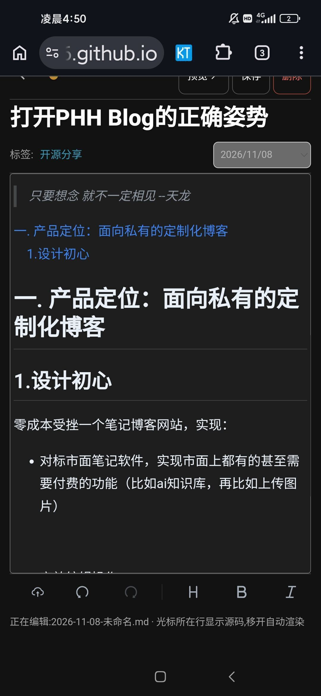
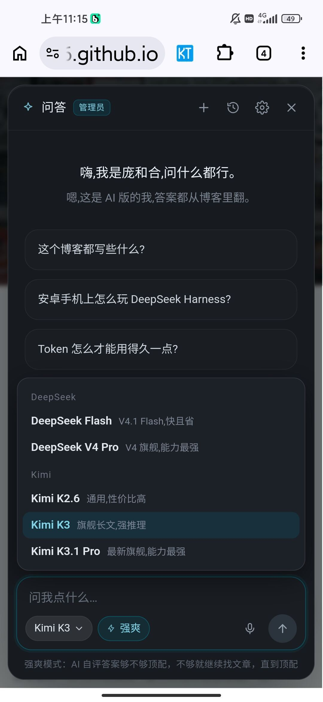
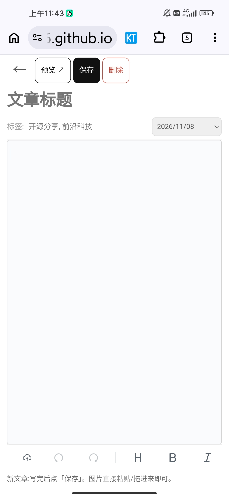

> 只要想念 就不一定相见  --天龙

[toc]

# 一.产品定位：面向私有的定制化个人博客

## 1.设计初心

零成本手搓一个笔记博客，实现：

* 对标市面笔记软件，实现它们有，甚至需要付费的功能（如markdown图片上传，ai知识库）
* 便捷高效操作
* 良好的隐私管理与权限分层

总结下来就一句话，市面上有的我有，市面上要钱的我更有。

听到这是不是有小伙伴已经饥渴难耐了啊？是不是想感觉fuck...哦不，fork一下试试了？

那就想着念着吧，具体来讲请看产品定位

## 2.未来展望

但也别灰心，未来可能会出发行版或测试版来面向公众

but，上手门槛肯定会变高，并且注定是阉割版。

# 二.打开该博客的正确方式

## 1.管理员：打开世界的钥匙

在你登陆之前，它只是一个平平无奇的静态网业。但当你获取权限，你将打开新世界的大门。你将解锁以下技能（包括但不限于）：

* 隐私文章：只有你才能看到的加密文章。
* ai知识库：该博客的灵魂，它可以根据博客内容回答你的问题。
* 文章的增删查该：直接网页端操作。

可惜，你是游客，你获取不了管理员权限。

## 2.AI:生产力的牛马

我的三大牛马：

* 改功能：[gork-build](https://panghehe666.github.io/2026/10/07/introduce-grok/)自带github连接器，build模式能力在线，fast也还凑合
* 做项目报告：[千问](https://panghehe666.github.io/2026/10/25/introduce-qianwen/) ，深度研究，真一行一行读代码，一个一个试功能
* 写文章：[DSH](https://panghehe666.github.io/2026/10/17/deepseek-harness-android/) ，文笔严谨，没gork那么强的ai味儿，gork不够用了该功能也能退而求其次。

至于ai提问，我推荐kimi，不像deepseek那么死。但是价格么，就是另一个问题了。

## 3.文章的增删改

可以用ai也可以直接撸，毕竟现代用的笔记ui已经相对现代

