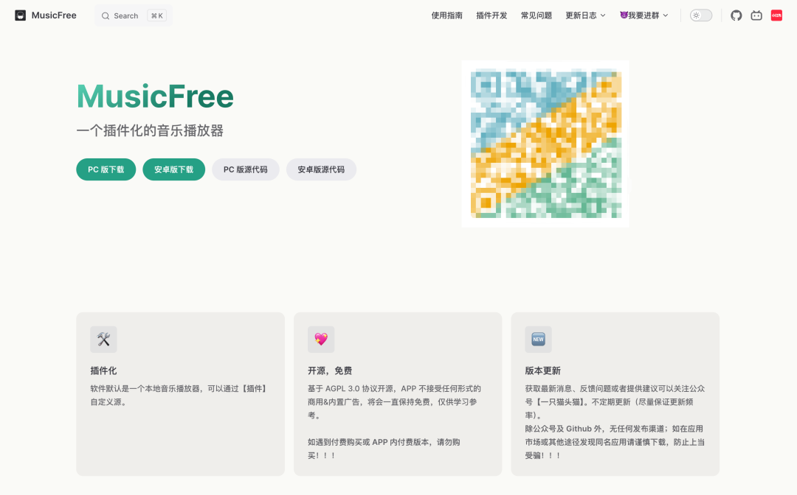
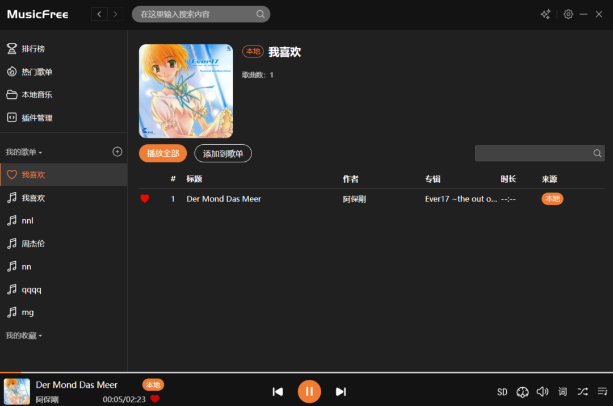
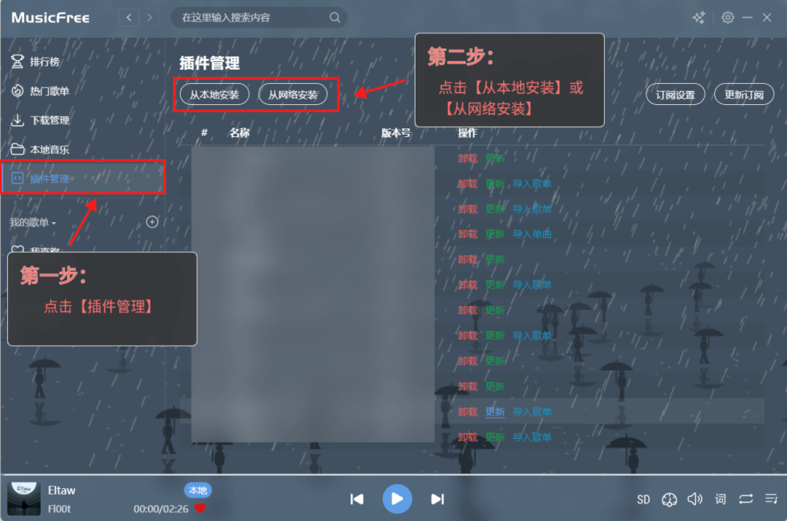
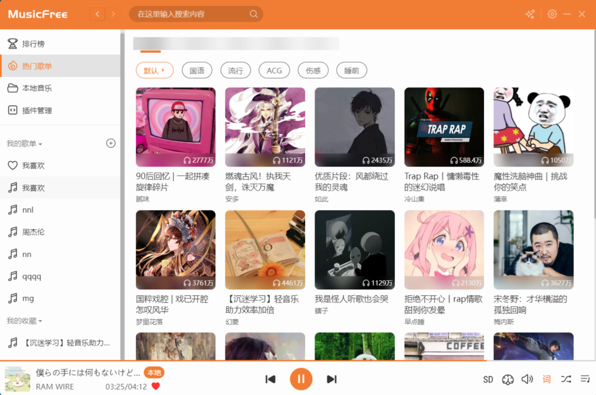

> 周董发新歌了～

平时下了班或者休息的时候想听听歌，打开音乐App，就会发现想听的歌曲要么需要会员，要么直接变灰听不了。更烦的是，不同平台的歌单分散在各处，想听全还得来回切换不同APP。

今天这就分享Github上大佬maotoumao开发的一款**完全开源、无广告、插件化**的音乐播放器——**MusicFree**。它本身不自带任何音源，但通过插件机制，你可以接入各种音乐服务，实现"一个App听遍全网音乐"。

## 软件简介

MusicFree 是一款基于 TypeScript + Electron 开发的桌面端音乐播放器，支持 **Windows、macOS、Linux、Android、Harmony OS **五大主流平台。

### 核心特点

| 特性 | 说明 |
|---|---|
| 🎵 插件化 | 通过插件接入不同音源，自由扩展 |
| 🔒 完全开源 | GitHub 开源，代码透明可审计 |
| 🚫 无广告 | 纯净体验，没有任何商业推广 |
| 🎨 个性主题 | 支持浅色/深色模式，可自定义配色 |
| 📱 跨平台 | Windows、macOS、Linux、Android、Harmony OS 全支持 |
| 💾 本地收藏 | 歌单、播放记录本地存储，隐私安全 |

## 安装教程

### 1. 下载安装包

访问最上方 GitHub Releases 页面，根据你的系统选择对应版本：

- Windows：MusicFree-xxx-win32-x64.exe

- macOS：MusicFree-xxx-mac.dmg

- Linux：MusicFree-xxx-linux.AppImage

- Android: xxx.apk

### 2. 安装插件

MusicFree 本身只是一个播放器框架，**需要安装插件才能播放音乐**，具体安装步骤如下：

1. 打开 MusicFree 软件，点击左侧「插件管理」

1. 点击「从网络安装」

1. 输入插件地址（可在 GitHub 搜索 “musicfree-plugin” 找到社区维护的插件源，或者直接输入 [https://raw.gitcode.com/maotoumao/MusicFreePlugins/raw/master/plugins.json](https://raw.gitcode.com/maotoumao/MusicFreePlugins/raw/master/plugins.json) ）

1. 安装完成后，在“音源”中选择对应的插件即可使用

> ⚠️ 注意：插件由社区维护，请自行判断可靠性

## 使用体验

### 界面简洁，操作直观

MusicFree 的界面非常清爽，左侧是导航栏（首页、搜索、歌单、设置），中间是内容区，底部是播放控制栏。没有任何多余的元素，专注于音乐本身。

### 搜索功能强大

在搜索框输入歌名或歌手，MusicFree 会调用已安装的插件进行搜索，结果来自多个音源，可以对比自己选择音质最好的版本。

### 歌单管理灵活

- 支持创建本地歌单

- 支持导入外部歌单（通过插件）

- 播放记录自动保存

- 支持歌词显示

### 音质选择

大部分插件支持多种音质选择，从标准音质到无损音质，根据网络情况自由切换。

## 对比其他播放器

| 功能 | MusicFree | 主流音乐APP |
|---|---|---|
| 费用 | 完全免费 | 部分功能需会员 |
| 广告 | 无 | 有 |
| 开源 | ✅ | ❌ |
| 插件扩展 | ✅ | ❌ |
| 跨平台 | ✅ | 部分支持 |
| 隐私保护 | 本地存储 | 云端同步 |

## 写在最后

MusicFree 的设计理念很纯粹：**做一个干净、开放、可扩展的音乐播放器**。它不像各种听歌APP那样追求大而全，而是把选择权交给用户——用什么音源、怎么管理歌单，完全由你决定。

如果你也厌倦了各种限制和广告，不妨试试这款开源神器吧。

## 下载方式

1. Github 开源地址，点击右侧的release下载手机版：[https://github.com/maotoumao/MusicFree](https://github.com/maotoumao/MusicFree) 

桌面版：[https://github.com/maotoumao/MusicFreeDesktop](https://github.com/maotoumao/MusicFreeDesktop)

1. 项目网站，有详细介绍和所有版本的下载链接[https://musicfree.catcat.work/](https://musicfree.catcat.work/)

1. 关注公众号后，回复关键词 “ **MusicFree **” 或者 “ **128 **”，即可获取windows和安卓安装包的下载链接。

> © 免责声明

> 1.本公众号所有内容均来源于网络，版权归原版权方所有。如果侵犯了您的合法权益，请联系我们会及时删除。

> 2.本公众号资源均来自互联网收集整理，仅供大家学习交流使用，不得用于任何商业用途。若使用商业用途，请购买正版授权，否则一切后果将由下载用户本人自行承担！
